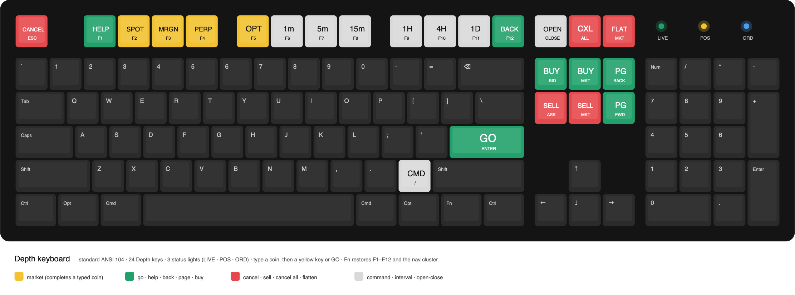

# Depth keyboard

A standard full-size keyboard with the function row, the system keys and the edit cluster repainted
for trading, Bloomberg style. The typing area and the numpad stay as they are. Three status lights
show what Depth is doing.



## The keys

The colors follow Bloomberg's grammar:

- **Yellow** keys are markets. They finish a typed coin: type `eth`, press **PERP**.
- **Green** keys are go and navigation.
- **Red** keys stop or cancel. The two that act on a whole symbol (cancel all, flatten) sit alone in
  the top-right corner, as far as possible from GO.
- **White** keys change the view.

| Key | Depth | Sends |
|---|---|---|
| Esc | CANCEL: close the dialog / command line | Esc |
| F1 | HELP: every key and command word | Ctrl+Alt+F13 |
| F2 … F5 | SPOT, MRGN, PERP, OPT | Ctrl+Alt+F14 … F17 |
| F6 … F8 | 1m, 5m, 15m | Ctrl+Alt+F18 … F20 |
| F9 … F11 | 1H, 4H, 1D | Ctrl+Alt+Shift+F13 … F15 |
| F12 | BACK: previous coin / market (press again to come back) | Ctrl+Alt+Shift+F16 |
| PrtSc | OPEN / CLOSE: the order panel's tab | Ctrl+Alt+Shift+F17 |
| ScrLk | CXL ALL: cancel the symbol's orders on the trading venue | Ctrl+Alt+Shift+F18 |
| Pause | FLAT: close the symbol's positions on the trading venue at market | Ctrl+Alt+Shift+F19 |
| Insert | BUY BID: limit at the venue's own bid | Ctrl+Alt+Shift+F20 |
| Home | BUY MKT | Ctrl+Shift+F13 |
| Page Up | PG BACK: previous favorite | Ctrl+Shift+F14 |
| Delete | SELL ASK: limit at the venue's own ask | Ctrl+Shift+F15 |
| End | SELL MKT | Ctrl+Shift+F16 |
| Page Down | PG FWD: next favorite | Ctrl+Shift+F17 |
| Knob turn | size up / down (5 % per detent), or the limit price (1 tick) | Ctrl+Shift+F18 / F19 |
| Knob push | switch the knob between size and price | Ctrl+Shift+F20 |
| Enter | GO: confirm | Enter |
| `/` | CMD: command line | `/` |

The codes use F13–F20 under Ctrl+Alt, Ctrl+Alt+Shift or Ctrl+Shift. No OS or app uses those by
default. Plain F14 / F15 dim the screen on macOS, which is why they never go out bare. Fn gives back
F1–F12, PrtSc / ScrLk / Pause and the edit cluster.

Typing anywhere in Depth starts the command line, as on a Bloomberg: `eth` GO, `eth` PERP,
`sol 1h bybit` GO.

**Trading keys do nothing until an order size is set** (Settings > Hotkeys > Order size, USDT).
They go through the same confirmation as the order panel's buttons. On the Close tab, buy closes the
short and sell closes the long.

## Three ways to use it

1. **Any keyboard, no flashing.** Settings > Hotkeys lets you bind every action to any key.
2. **A VIA / Vial keyboard, no flashing.** In VIA, set each key to the code in the table, using the
   "Any" key: `LCTL(LALT(KC_F13))` for HELP, `LCTL(LALT(LSFT(KC_F13)))` for 1H, and so on. Then press
   **Depth keyboard layout** in Settings > Hotkeys. This gives you every key, but no lights.
3. **A QMK keyboard with the Depth firmware: keys and lights.** Flash the build for your board from
   the release (Keychron Q6 ANSI with knob first), then press **Depth keyboard layout** in Depth.
   VIA keeps working for remapping.

## Status lights

| Light | On | Blinks |
|---|---|---|
| LIVE | Depth connected, market data arriving | |
| POS | a position in the current symbol | slowly past −10 % ROE |
| ORD | orders resting in the current symbol | fast: a confirmation is waiting, or an order was rejected in the last 10 s |

Keyboards with discrete Num / Caps / Scroll Lock LEDs show them there; the lock keys no longer
drive those LEDs. On an RGB keyboard they are keys named by the keymap. On the Q6 they are the first
three keys over the numpad. With RGB, the current market key, the interval key and the OPEN / CLOSE
key (on Close) are lit too, and GO flashes while a confirmation waits.

If Depth stops sending for 3 s, the keyboard shows "not live" and drops the highlights.

## Protocol

Depth finds the keyboard on its raw HID interface (usage page `0xFF60`, usage `0x61`, the QMK
default) and says hello. Only a keyboard that answers gets anything more. Reports are 32 bytes:

```
host → keyboard   D7 00                          hello
keyboard → host   D7 00 01                       protocol version 1
host → keyboard   D7 01 <flags> <market> <tf>    state, on change and every second
```

- flags: bit 0 live, 1 position, 2 position in loss, 3 orders, 4 attention, 5 Close tab.
- market: 0 spot, 1 margin, 2 perp, 3 option.
- tf: 0–5 = 1m 5m 15m 1h 4h 1d, `FF` other.

`0xD7` is not a VIA command id. With VIA on, the reports arrive through VIA's `via_command_kb` hook,
so the two share the interface.

## Firmware

```
qmk/users/depth/          the userspace: codes (depth.h), protocol, lights (depth.c), shared by every board
qmk/keymaps/<board>/      one keymap per board: places the codes, says where the status shows (config.h)
```

CI builds each keymap in a fresh QMK tree (`.github/workflows/build.yml`, job `firmware`). To add
a board:

1. Copy its default keymap to `qmk/keymaps/<vendor>_<board>/`.
2. Put the `DK_` codes on the keys above.
3. In `config.h`, set `DEPTH_STATUS_KEYS` (and optionally `DEPTH_MARKET_KEYS`, `DEPTH_TF_KEYS`,
   `DEPTH_GO_KEY`, `DEPTH_OPCL_KEY`) to the matrix positions from its `keyboard.json`.
4. Add `VIA_ENABLE = yes` to `rules.mk` if the board supports VIA.
5. Add a build line to the `firmware` job.

`ui/src/hotkeys.rs` has a test that checks every code in `depth.h` against the app's own table.

## Keycaps

`layout.svg` is the legend sheet at real size (1u = 19.05 mm). The sizes are standard: everything
is 1u except Enter (2.25u), so any ANSI set with spare colored 1u caps fits. Colors: yellow
`#F2C230`, green `#22A06B`, red `#E5484D`, white `#D9D9D9`.
